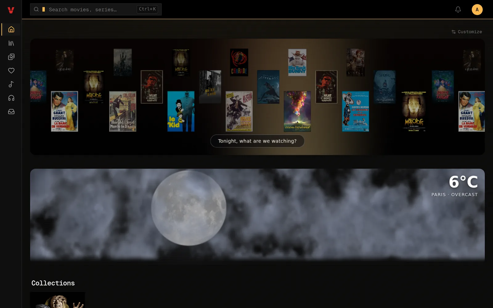
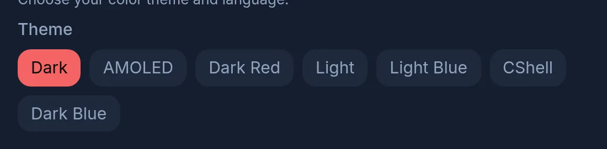

# 🖥️ CShell

**A terminal look for Evey: true black, amber, monospace, scanlines and square corners.**



## What it changes

- ⬛ **True black and amber**, like an old terminal screen.
- 🔤 **A monospace typeface** everywhere (Geist Mono, shipped inside the theme, so it looks the same on every computer).
- 📺 **Soft CRT scanlines** and **square corners**.
- 📊 **A framed dashboard** in the admin pages.

It only changes how Evey looks: a theme runs no code on the server and asks for no permission.


## Install

1. In Evey, open **Admin > Plugins** and click **Install Plugin**.
2. Choose **From URL** and paste `https://github.com/eveyproject/evey-theme-cshell`.
3. The preview says it is **Signed by Evey project**. Click **Install**.

## Use it

Each profile picks its own theme: open **Settings > Appearance** and click **CShell**. To go back, click **Dark** (Evey's own look).



<details>
<summary><b>For developers</b></summary>

Everything is CSS on Evey's stable theming hooks, and passes Evey's theme sanitizer. See [Themes](https://github.com/eveyproject/evey/blob/master/docs/themes.md) for what a theme may change.

### Build and release

```sh
./scripts/build-zip.sh      # -> out/cshell-<version>.zip
```

The same commit always gives the same zip, so a rebuild can be compared with a published release byte for byte. To release, bump `version` in `plugin.yaml` and push a tag `v<version>`: the workflow builds, signs with the project key and publishes `cshell-<version>.zip`, its cosign signature and its sha256.

The Evey project key has the fingerprint `sha256:c29eb603b19d99a50f3fa6c94b7e92c41710779261e73e0fa31d53a78902e09a`. Compare it with the one the install preview shows before you trust it.

</details>

## License

MIT, see [LICENSE](LICENSE). The theme embeds the Geist Mono typeface (Copyright 2024 The Geist Project Authors), under the SIL Open Font License 1.1: see [OFL.txt](OFL.txt).
